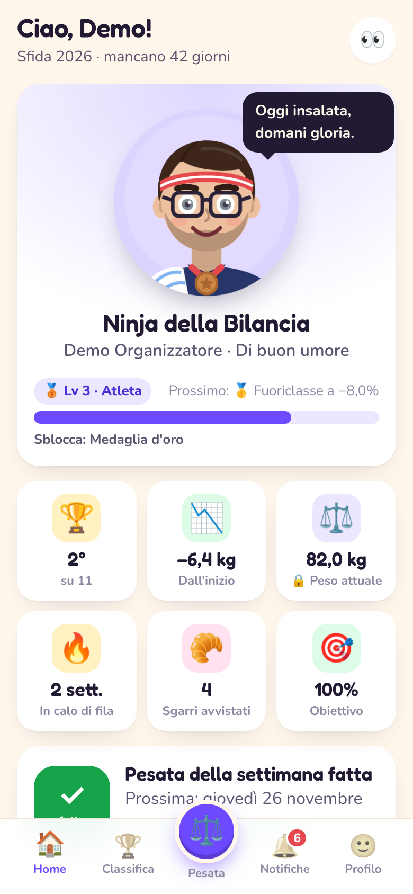
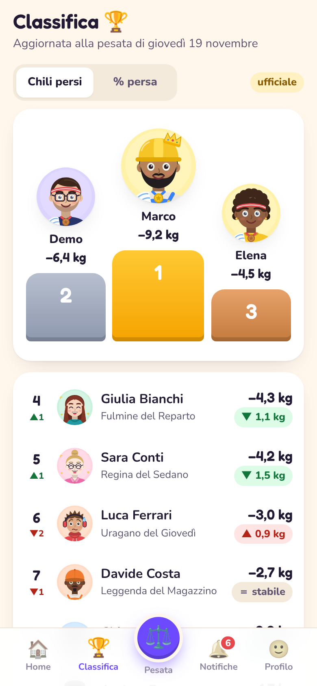
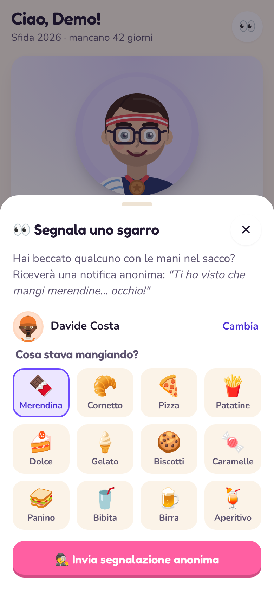
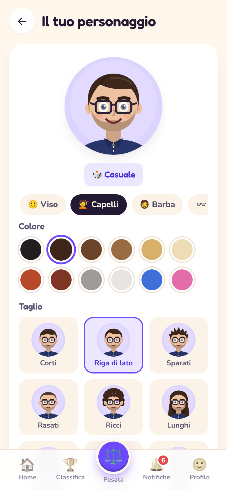
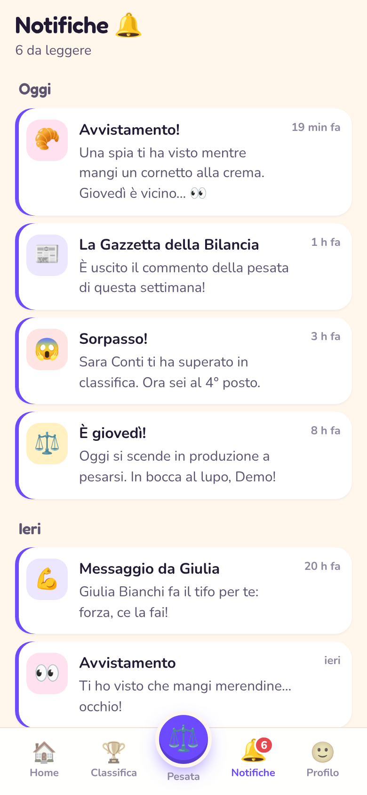

# ⚖️ Chi Perde Vince

**La sfida del giovedì**: ogni giovedì si scende in produzione a pesarsi e a fine anno vince chi ha perso di più.
Questa app dà a ogni collega un account con il proprio **personaggio creato da una foto**, una **dashboard interattiva**, la **classifica** e le **notifiche** (anche quelle tipo *"Ti ho visto che mangi merendine... occhio! 👀"*).

<p align="center">
  
  
  
</p>
<p align="center">
  
  
</p>

## Cosa fa

- **Account per ognuno**: registrazione con codice invito, il primo iscritto diventa l'organizzatore.
- **Personaggio dalla foto**: dopo la registrazione l'app chiede un selfie e crea l'avatar.
  - con Claude (chiave API Anthropic) la foto viene analizzata dall'AI: capelli, barba, occhiali, vestiti, colori, più un soprannome da gara ("Fulmine del Reparto");
  - senza chiave l'app ricava i colori dalla foto (pelle, capelli, maglia) direttamente sul telefono;
  - in entrambi i casi si rifinisce tutto nell'editor (13 tagli di capelli, barba, occhiali, accessori come il caschetto da produzione, vestiti, sfondo).
- **Il personaggio vive**: cambia espressione in base all'ultima pesata (felice, alle stelle, preoccupato, giornata no), tiene in mano la merendina se qualcuno l'ha appena beccato, guadagna fascia, asciugamano, medaglie e aura salendo di livello, e mette la corona se è primo. Toccalo e ti risponde.
- **Dashboard interattiva**: icone di stato toccabili (posizione, kg dall'inizio, peso attuale, serie positiva, sgarri, obiettivo), conto alla rovescia al giovedì, rivali davanti e dietro, grafico del peso, badge, fine sfida.
- **Pesata**: inserimento con "bilancia" digitale, anche per settimane passate; coriandoli se il peso scende. L'organizzatore può inserire le pesate di tutti in un colpo solo dalla bilancia in produzione.
- **Classifica**: podio animato, posizioni guadagnate/perse, variazione della settimana; ordinabile per kg o per percentuale (la modalità ufficiale la sceglie l'organizzatore).
- **Profili dei colleghi**: grafico della variazione, badge, messaggi rapidi ("Forza!", "Sto arrivando 😈", "Pizza stasera? 🍕") e il pulsante **👀 Ho beccato qualcuno con uno sgarro**: la persona riceve una notifica anonima.
- **Notifiche push** sul telefono (e nell'app): promemoria del mercoledì sera e del giovedì, sorpassi in classifica, badge sbloccati, frecciatine all'ora della merenda (ognuno sceglie quante riceverne), la **Gazzetta della Bilancia** del giovedì sera e il conto alla rovescia di fine sfida.
- **Privacy**: il peso lo vede solo il diretto interessato (e l'organizzatore che lo inserisce); i colleghi vedono solo i chili persi. La foto non viene salvata.

## Avvio rapido (sul tuo computer)

Serve [Node.js](https://nodejs.org) 22.13 o successivo.

```bash
npm install
```

```bash
npm run dev
```

Apri <http://localhost:5173>: il primo account che crei è l'organizzatore. Il codice invito per i colleghi è nel pannello organizzatore (Profilo → 🛠️ Pannello organizzatore → Iscritti), insieme al link da condividere.

Per provare l'app già piena di dati (11 colleghi, 12 settimane di pesate), usa un database separato:

```bash
DATA_DIR=./data-demo npm run seed:demo
```

```bash
DATA_DIR=./data-demo npm run dev
```

e accedi con `demo@chiperdevince.it` / `demo1234`.

## Metterla online

Per usarla dai telefoni l'app deve stare su un indirizzo **HTTPS** (la fotocamera, le notifiche push e l'installazione come app lo richiedono). È un unico server Node con un database SQLite in un file: serve un hosting con un **disco persistente**. GitHub Pages non basta: ospita solo pagine statiche, mentre qui servono un database condiviso, i login e l'invio delle notifiche agli orari stabiliti.

### Con Render (anche tutto da telefono)

[](https://render.com/deploy?repo=https://github.com/w8997wnwy5-collab/app_itrl_pdp)

1. Tocca il pulsante qui sopra e accedi a Render con GitHub.
2. Render legge `render.yaml`: servizio Docker *Starter* a Francoforte con un disco da 1 GB montato su `/data` (circa 7 $ al mese + 0,25 $ per il disco; il piano gratuito non ha dischi e va in pausa, quindi niente notifiche).
3. Conferma con **Deploy Blueprint**, inserisci il metodo di pagamento e aspetta qualche minuto la prima build.
4. Apri l'indirizzo `https://chi-perde-vince….onrender.com` e registrati per primo: diventi l'organizzatore.
5. (Facoltativo) In *Environment* aggiungi `ANTHROPIC_API_KEY` per l'avatar con l'AI, poi *Save*.

Gli aggiornamenti del codice si pubblicano da Render con **Manual Deploy → Deploy latest commit** (il deploy automatico è spento per sicurezza).

### Con Docker (server tuo)

```bash
docker build -t chi-perde-vince .
```

```bash
docker run -d --name chi-perde-vince -p 3000:3000 -v cpv-data:/data chi-perde-vince
```

Davanti mettici un proxy HTTPS, per esempio [Caddy](https://caddyserver.com) con un `Caddyfile` così:

```
sfida.miaazienda.it {
  reverse_proxy localhost:3000
}
```

Va bene anche qualsiasi altro hosting che esegua il `Dockerfile` con un volume persistente su `/data` (Railway, Fly.io...). Senza volume il database si cancella a ogni deploy.

### Senza Docker

```bash
npm ci && npm run build
```

```bash
NODE_ENV=production DATA_DIR=/percorso/dati PORT=3000 npm start
```

## Configurazione

Tutte facoltative (vedi `.env.example`):

| Variabile | A cosa serve |
|---|---|
| `PORT` | Porta del server (default 3001 in sviluppo, 3000 nel Docker) |
| `DATA_DIR` | Cartella del database SQLite. **Fanne il backup**: è tutto lì dentro |
| `PUBLIC_URL` | Indirizzo pubblico, es. `https://sfida.miaazienda.it` |
| `INVITE_CODE` | Codice invito fisso; se vuoto ne viene generato uno (modificabile dal pannello) |
| `ANTHROPIC_API_KEY` | Attiva Claude per l'avatar dalla foto e la Gazzetta scritta dall'AI |
| `CLAUDE_MODEL` | Modello Claude (default `claude-opus-5-5`) |
| `VAPID_PUBLIC_KEY` / `VAPID_PRIVATE_KEY` | Chiavi per le notifiche push; se vuote vengono generate e salvate nel database |
| `VAPID_SUBJECT` | Contatto per i servizi push (`mailto:` o `https://`); se vuoto si usa l'indirizzo https dell'app |
| `SCHEDULER` | `0` per disattivare promemoria e sfottò programmati |
| `COOKIE_SECURE`, `TRUST_PROXY` | Già corretti in produzione dietro un proxy HTTPS |

Dal pannello organizzatore si impostano anche: nome della sfida, date di inizio e fine (di default 1 gennaio → 31 dicembre), classifica per **kg** o per **percentuale** (più equa tra pesi di partenza diversi) e se le pesate le registra solo l'organizzatore.

## Installare l'app sul telefono

- **Android (Chrome)**: apri l'indirizzo, menu ⋮ → *Installa app*.
- **iPhone (Safari)**: tasto Condividi ⬆️ → *Aggiungi alla schermata Home*. Su iPhone le notifiche push funzionano solo dall'app aggiunta alla Home (iOS 16.4 o successivo).

Poi Profilo → *Notifiche su questo dispositivo* (c'è anche il pulsante per una notifica di prova).

## Calendario delle notifiche (ora italiana)

| Quando | Cosa | A chi |
|---|---|---|
| Lunedì 9:00 | Motivazione di inizio settimana | chi accetta gli sfottò |
| Lun–ven 10:30 e lun–mer, ven 16:00 | Frecciatina all'ora della merenda (venerdì: pizza e aperitivi) | a caso, in base al livello scelto (gentile 10%, normale 25%, piccante 50% per fascia) |
| Mercoledì 18:30 | "Domani si pesa! Cena leggera..." | chi accetta gli sfottò |
| Giovedì 8:30 | "È giovedì! Oggi si scende in produzione" | tutti |
| Giovedì 15:00 | Promemoria a chi non ha ancora registrato la pesata | chi manca |
| Giovedì 18:00 | La Gazzetta della Bilancia | tutti |
| −30, −14, −7, −3, −1 giorni | Conto alla rovescia di fine sfida | tutti |
| Giorno dopo la fine | Annuncio del vincitore 🏆 | tutti |

In più, in tempo reale: avvistamenti di sgarri (anonimi), messaggi dei colleghi, sorpassi, risultati inseriti dall'organizzatore e badge sbloccati.

## Claude (facoltativo)

Con `ANTHROPIC_API_KEY` impostata l'app usa Claude per due cose:

1. **Avatar dalla foto**: il selfie (ridotto a max 1024 px) viene inviato all'API di Anthropic, che restituisce le caratteristiche del personaggio in un formato strutturato (*structured outputs*) e un soprannome. La foto non viene salvata dall'app. Al modello è chiesto di non commentare mai peso, corpo, età o etnia.
2. **La Gazzetta della Bilancia**: un commento da telecronista sulla pesata della settimana, basato solo sulle variazioni (mai sui pesi).

Il modello predefinito è `claude-opus-5-5` (cambialo con `CLAUDE_MODEL`). Le richieste usano il *fallback* lato server di Anthropic (`fallbacks: "default"`), così se il modello rifiuta una richiesta per motivi di policy viene riprovata in automatico sul modello consigliato. Il costo è di pochi centesimi: una chiamata per ogni avatar e una a settimana per la Gazzetta. Senza chiave l'app funziona lo stesso, con la stima dei colori dalla foto e una Gazzetta generata da modelli di testo.

## Sviluppo

```bash
npm test
```

```bash
npm run typecheck
```

- `server/`: API Express 5 + SQLite (`node:sqlite`), notifiche push (`web-push`), scheduler, integrazione Claude.
- `shared/`: regole del gioco, avatar, date (fuso Europe/Rome) condivise tra server e app.
- `web/`: app React (PWA) con Vite; `web/public/sw.js` è il service worker per offline e notifiche.
- `web/dev/avatars.html`: galleria di tutte le varianti dell'avatar, solo in sviluppo (<http://localhost:5173/dev/avatars.html>).
- `scripts/seed-demo.ts`: dati demo.
- `tests/`: test (statistiche e classifica, date, scheduler, API, integrazione Claude simulata).
